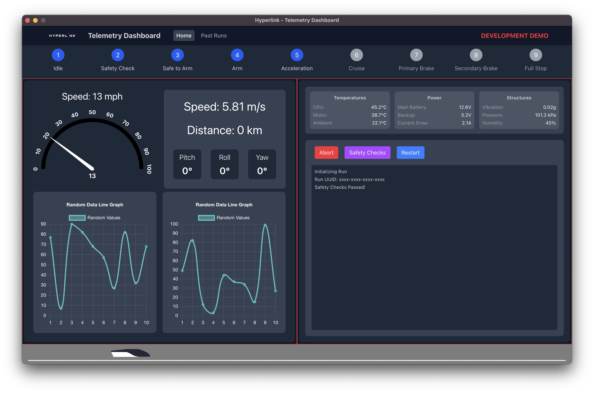

# Electron Dashboard

The Hyperlink Dashboard is a cross-platform desktop application built using Electron and React, providing a modern and efficient interface for monitoring and managing software systems.

## Architecture

The dashboard follows a modern desktop application architecture:

- **Electron Backend**: Handles the desktop application lifecycle, window management, and system integration
- **React Frontend**: Provides a responsive and interactive user interface
- **Development Environment**: Uses Vite for fast development and hot module replacement
- **Build System**: Electron Builder for creating distributable packages across multiple platforms

Key architectural features:
- Secure by default with `nodeIntegration: false` and `contextIsolation: true`
- Cross-platform support for Windows, macOS, and Linux
- Development mode with hot reloading
- Production builds with optimized assets

## Features

The dashboard provides the following core features:

- **Cross-Platform Support**: Available for Windows, macOS, and Linux
- **Responsive Design**: Adapts to different screen sizes and resolutions
- **Development Mode**: Hot reloading for rapid development
- **Secure Architecture**: Built with security best practices in mind
- **Auto-Updates**: Integrated with GitHub releases for seamless updates

## User Interface

The dashboard features a modern, responsive interface built with React:

- Clean and intuitive design
- Responsive layout that adapts to different screen sizes
- Modern UI components and styling
- Efficient state management
- Real-time data updates

## Data Visualization

[Content to be added - specific visualization components and features]

## Best Practices

The dashboard implementation follows these best practices:

1. **Security**:
   - Disabled nodeIntegration for enhanced security
   - Enabled contextIsolation to prevent global access
   - Proper content type headers for JavaScript files

2. **Performance**:
   - Optimized build process
   - Efficient asset loading
   - Proper resource management

3. **Development**:
   - Clear separation between frontend and backend
   - Hot module replacement for faster development
   - Consistent code style with ESLint
   - Environment variable management

4. **Deployment**:
   - Automated build process
   - Cross-platform packaging
   - GitHub release integration
   - Proper version management 