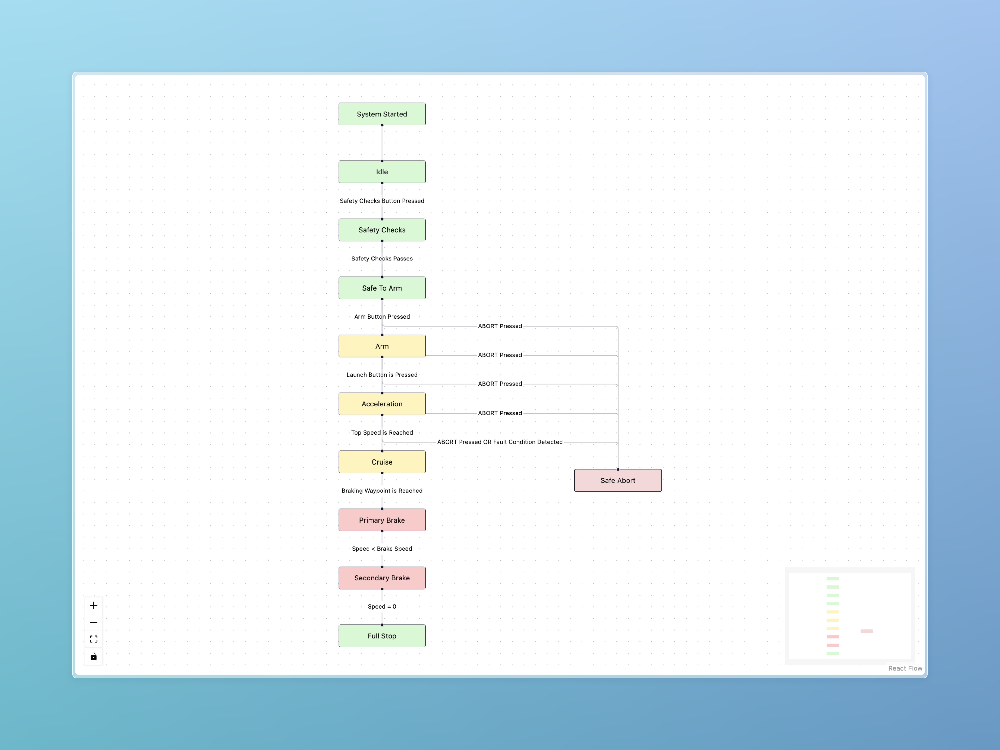

# Finite State Machine (FSM)



The On-Board Computer (OBC) uses a Finite State Machine to control the Hyperlink pod through a well-defined set of states and transitions. The FSM is implemented in Python using the `transitions` library and drives brake/propulsion outputs based on sensor and button inputs.

## FSM Architecture

### Overview

The FSM lives in the OBC repo under `src/fsm/`. The main class is **StateMachine** (subclass of `transitions.Machine`). It is created once by the **Comms** layer and updated every loop with the latest **MessageIn** data. Each state’s `run()` method returns a tuple:

- **Event** – which transition to trigger (or “stay”)
- **Primary brakes engaged** – boolean
- **Secondary brakes engaged** – boolean
- **Propulsion engaged** – boolean
- **Current state** – string for logging/API

The Comms layer aggregates sensor/button data into a single `MessageIn`, calls `state_machine.run_current_state(message_in)`, gets a **MessageOut** (brakes/propulsion/state), and sends that to the ESPs and API.

### Design choices

- **Strict transitions**: `auto_transitions=False` and `ignore_invalid_triggers=False` so only defined transitions are allowed and invalid triggers raise.
- **Queued processing**: `queued=True` so triggers are processed one at a time.
- **Event payload**: `send_event=True` so transition callbacks receive full event data.
- **Lifecycle hooks**: `before_state_change` (e.g. validation) and `after_state_change` (e.g. logging) run on every transition.

### Integration with Comms

The **Comms** class in `src/comms/comms.py` owns a single **StateMachine** instance. Each main loop it:

1. Receives **MessageIn** data from ESPs (braking and propulsion) and merges it into `current_data`.
2. Calls `state_machine.run_current_state(current_data)`.
3. Gets a **MessageOut** (primary_brakes_on, secondary_brakes_on, propulsion_on, current_state).
4. Sends that **MessageOut** to the ESPs and to the API via WebSocket.

So the FSM is the single source of truth for brake and propulsion commands; Comms only aggregates inputs and forwards outputs.

### FSM constants (environment)

Behavior is parameterized via `.env` and `FSMConstants` in `constants.py`:

| Constant | Description |
|----------|-------------|
| `MAX_SPEED` | Cruising speed (m/s); used for acceleration → cruise |
| `WAYPOINT_DISTANCE` | Distance (m) for braking waypoint |
| `MAX_TEMP_PROPULSION` | Max propulsion temperature (°C) |
| `MAX_TEMP_BRAKING` | Max brake temperature (°C) |
| `MAX_RPM` | Max RPM limit |
| `SECONDARY_BREAKING_SPEED` | Speed (m/s) below which secondary braking is used |

---

## States

### 1. Idle

**Role**: Default state; pod at rest, no propulsion, no brakes. Waits for operator to start safety checks or to abort.

- **Transitions out**: `safety_button` → Safety Checks, `abort` → Safe Abort
- **Outputs**: Brakes off, propulsion off
- **Inputs**: Safety button, abort button; continuous checks on propulsion/brake temps and RPM (over limit → abort)

### 2. Safety Checks

**Role**: Run pre-arm safety checks. Stays until checks pass/fail or operator aborts.

- **Transitions out**: `safety_pass` → Safe to Arm, `safety_fail` → Idle, `abort` → Safe Abort
- **Outputs**: Brakes off, propulsion off
- **Inputs**: `safety_checks_passed` (true/false/None), abort; same temperature/RPM limits as Idle

### 3. Safe to Arm

**Role**: System is safe; waiting for operator to press and hold arm button.

- **Transitions out**: `arm_button_pressed` → Armed, `fault` → Idle, `abort` → Safe Abort
- **Outputs**: Brakes off, propulsion off
- **Inputs**: Arm button, fault condition, abort; same temperature/RPM limits

### 4. Armed

**Role**: Operator is holding arm; system ready for launch. Release arm or press launch.

- **Transitions out**: `arm_button_released` → Safe to Arm, `launch_button` → Acceleration, `fault` → Idle, `abort` → Safe Abort
- **Outputs**: Brakes off, propulsion off
- **Inputs**: Arm released, launch button, fault, abort; same temperature/RPM limits

### 5. Acceleration

**Role**: Pod is accelerating. Transition when top speed is reached or a braking waypoint is reached.

- **Transitions out**: `top_speed_reached` → Cruise, `waypoint_reached` → Primary Braking, `abort_or_fault` → Safe Abort
- **Outputs**: Propulsion on, brakes off (until transition)
- **Inputs**: Speed (vs `MAX_SPEED`), distance (vs `WAYPOINT_DISTANCE`), abort, fault; same temperature/RPM limits

### 6. Cruise

**Role**: Pod at cruising speed. Wait for braking waypoint.

- **Transitions out**: `braking_waypoint_reached` → Primary Braking, `abort_or_fault` → Safe Abort
- **Outputs**: Propulsion on, brakes off
- **Inputs**: Distance (vs `WAYPOINT_DISTANCE`), abort, fault; same temperature/RPM limits

### 7. Primary Braking

**Role**: Primary brakes on; slow down until speed is at or below secondary braking threshold.

- **Transitions out**: `to_secondary_brake` → Secondary Brake, `abort_or_fault` → Safe Abort
- **Outputs**: Primary brakes on, propulsion off
- **Inputs**: Speed (vs `SECONDARY_BREAKING_SPEED`), abort, fault; same temperature/RPM limits

### 8. Secondary Brake

**Role**: Secondary brake on until pod is stopped.

- **Transitions out**: `to_full_stop` → Full Stop, `abort_or_fault` → Safe Abort
- **Outputs**: Secondary brakes on, propulsion off
- **Inputs**: Speed (0 → full stop), abort, fault; same temperature/RPM limits

### 9. Full Stop

**Role**: Pod stopped; all brakes can be released. Operator can disarm to return to Idle.

- **Transitions out**: `to_idle` → Idle, `abort_or_fault` → Safe Abort
- **Outputs**: Brakes off, propulsion off
- **Inputs**: Disarm button and confirmation that primary and secondary brakes are off → Idle; abort/fault → Safe Abort

### 10. Safe Abort

**Role**: Abort in progress; brakes applied as needed. When pod is stopped and abort is released, transition to Full Stop.

- **Transitions out**: `stopped_and_abort_released` → Full Stop
- **Outputs**: Brakes off, propulsion off (abort handling can override in Comms)
- **Inputs**: Speed (0) and abort button released

### 11. Emergency Stop

**Role**: Reserved for emergency stop; defined in the FSM but not currently used in the transition graph. Intended for future use.

---

## State Transitions

### Diagram (summary)

```
Idle ──safety_button──► Safety Checks ──safety_pass──► Safe to Arm ──arm_button_pressed──► Armed
  │         │                    │                           │              │
  │         │                    │ safety_fail               │ fault        │ launch_button
  │         │                    ▼                           ▼              ▼
  │         │                   Idle ◄──────────────────── Idle      Acceleration
  │         │                    ▲                                    │    │    │
  │         │ abort               │ abort                              │    │    │ waypoint_reached
  │         ▼                     │                                    │    │    ▼
  │    Safe Abort ◄───────────────┴────────────────────────────────────┘    │  Primary Braking
  │         │                                                                │    │
  │         │ stopped_and_abort_released                                     │    │ to_secondary_brake
  │         ▼                                                                │    ▼
  │    Full Stop ◄──────────────────────────────────────────────────────────┘  Secondary Brake
  │         │                                                                        │
  │         │ to_idle                                                               │ to_full_stop
  │         ▼                                                                       ▼
  └────► Idle                                                                  Full Stop
```

### Trigger summary

| Trigger | Source state(s) | Destination |
|--------|------------------|-------------|
| `safety_button` | Idle | Safety Checks |
| `abort` | Idle, Safety Checks, Safe to Arm, Armed | Safe Abort |
| `safety_pass` | Safety Checks | Safe to Arm |
| `safety_fail` | Safety Checks | Idle |
| `arm_button_pressed` | Safe to Arm | Armed |
| `fault` | Safe to Arm, Armed | Idle |
| `arm_button_released` | Armed | Safe to Arm |
| `launch_button` | Armed | Acceleration |
| `top_speed_reached` | Acceleration | Cruise |
| `waypoint_reached` | Acceleration | Primary Braking |
| `braking_waypoint_reached` | Cruise | Primary Braking |
| `abort_or_fault` | Acceleration, Cruise, Primary Braking, Secondary Brake, Full Stop | Safe Abort |
| `to_secondary_brake` | Primary Braking | Secondary Brake |
| `to_full_stop` | Secondary Brake | Full Stop |
| `to_idle` | Full Stop | Idle |
| `stopped_and_abort_released` | Safe Abort | Full Stop |

---

## Error Handling

### Invalid triggers

With `ignore_invalid_triggers=False`, triggering a transition that is not defined for the current state raises an exception. This surfaces logic errors during development.

### Abort and fault paths

- **Abort**: Available from Idle, Safety Checks, Safe to Arm, and Armed; always leads to **Safe Abort**. From motion states (Acceleration through Full Stop), **abort_or_fault** also goes to Safe Abort.
- **Fault**: From Safe to Arm or Armed, fault goes to **Idle**. In motion states, fault is treated as **abort_or_fault** and goes to **Safe Abort**.
- **Comms**: When an ESP is unresponsive, Comms sets an `abort_flag` and the abort handler sends brake/abort-style messages to ESPs regardless of FSM state.

### Continuous limits (all relevant states)

In Idle, Safety Checks, Safe to Arm, Armed, Acceleration, Cruise, Primary Braking, and Secondary Brake, the FSM checks every tick:

- Propulsion temperatures (1 & 2) ≥ `MAX_TEMP_PROPULSION` → abort
- Brake temperature ≥ `MAX_TEMP_BRAKING` → abort
- RPM ≥ `MAX_RPM` → abort

So thermal or RPM over-limit always drives the machine toward Safe Abort (or Idle when coming from pre-arm states).

### Before/after transition hooks

- **validate_before_transition**: Intended for extra checks before a transition is applied; can block or raise.
- **log_transition**: Runs after each transition for logging and debugging.

---

## Best Practices

1. **Do not add transitions in ad hoc code**  
   All transitions are defined on the StateMachine; use the existing triggers and event dictionary so behavior stays consistent and traceable.

2. **Keep state logic in state classes**  
   Each state’s `run()` should depend only on `MessageIn` and constants. Avoid global or Comms-specific state inside the FSM.

3. **Use FSM constants for thresholds**  
   Speeds, distances, temperatures, and RPM limits should come from `FSMConstants` (and thus `.env`) so they can be tuned without code changes.

4. **Treat Safe Abort as the main safety sink**  
   Any motion-state failure (abort, fault, or limit) should transition to Safe Abort so the pod is brought to a controlled stop before Idle or Full Stop.

5. **Test trigger coverage**  
   Ensure every trigger in the transition table is actually produced by some state’s `run()` return value and that the event dictionary maps those return values to the correct trigger methods.

6. **Log transitions**  
   Use `after_state_change` (and optional `before_state_change`) for auditing and debugging; the FSM already passes event data when `send_event=True`.
